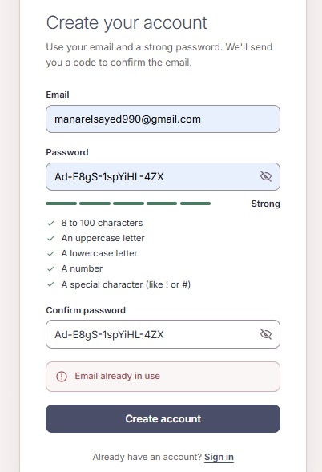
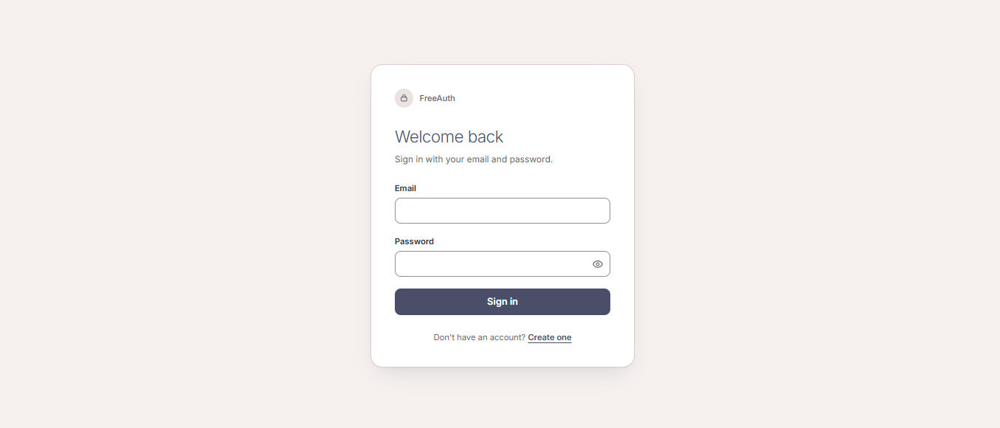

# Auth Card

## Overview

Auth Card is a single page with one centered card for signing in, creating an account and verifying an email with a 6-digit code. It is built with React, TypeScript and Tailwind CSS, and it talks to a mock of FreeAuth's auth API (`register`, `verify-email`, `login`) that runs in the browser with the same messages and status codes as the real endpoints. There is no backend: everything resets when you reload the page.

## Getting started

You need **Node.js 20.19+ or 22.12+** (Vite 8's requirement) and npm.

```bash
npm install
npm run dev
```

Then open the URL Vite prints (usually http://localhost:5173).

Other scripts:

```bash
npm run build     # type-check (tsc -b) and build to dist/
npm run preview   # serve the built dist/ folder
```

## Demo data

| What | How |
|---|---|
| Seeded, verified user | `ada@example.com` / `Str0ng!Pass` |
| OTP code | always `123456` |
| **409** Email already in use | Register with `ada@example.com` |
| **401** Invalid email or password | Sign in with a wrong password, or an email that has no account |
| **403** Please verify your email | Register a new account, click **Back to sign in** on the code screen, then sign in with it. The error has a **Verify your email** button that opens the code screen. |
| **400** Invalid or expired OTP | Enter any code other than `123456` |
| **429** Too many attempts | Enter a wrong code 5 times. The 5th wrong try returns 429 and locks that email for 15 minutes (reload the page to reset the mock) |
| **422** Validation failed (`errors[]`) | Use an email longer than 100 characters, e.g. `aaaaaaaaaaaaaaaaaaaaaaaaaaaaaaaaaaaaaaaaaaaaaaaaaaaaaaaaaaaaaaaaaaaaaaaaaaaaaaaaaaaaaaaaaaa@example.com`. The error appears under the Email field. |

Accounts you register live in memory until you reload.

## Project structure

```
src/
  main.tsx                 React entry point
  App.tsx                  Page layout: centers the card
  index.css                Tailwind import + @theme design tokens (colors, radii, shadow)
  types.ts                 AuthView union and the FieldError shape
  lib/
    mockApi.ts             register / verifyEmail / login with setTimeout, ApiError class
    passwordRules.ts       The password rules (one source of truth) + strength score
    validation.ts          Human error messages for email, passwords and confirm
    useFormState.ts        Small hook: values, when to show errors, focus first invalid field
  components/
    AuthCard.tsx           Holds the current view and switches between the three forms
    ViewHeader.tsx         The view's <h1>, focused when the view changes
    LoginForm.tsx          Login + the "You're signed in" state
    RegisterForm.tsx       Register with the strength indicator
    OtpForm.tsx            Code entry, submit, success redirect to Login
    ui/
      TextField.tsx        Label + input + error, wired with aria-invalid / aria-describedby
      PasswordField.tsx    TextField with a show/hide toggle button
      PasswordStrength.tsx Strength bar, text label and rules checklist
      OtpInput.tsx         Six digit boxes: typing, backspace, arrows, paste, autofill
      Button.tsx           Primary and link buttons, loading state with spinner
      Alert.tsx            Error (role="alert") and success messages
      icons.tsx            The few inline SVG icons
```

How it fits together: `AuthCard` keeps one `AuthView` in state. Each form gets callbacks such as `onRegistered(email)` or `onVerifyEmail(email)`, and calls them to move to the next view. The `otp` view always carries an email, so the code screen can't exist without one. The forms call the functions in `lib/mockApi.ts` and turn `ApiError`s into messages: errors with a matching `errors[]` field go under that field, everything else goes into an alert. `RegisterForm` and `PasswordStrength` both read `lib/passwordRules.ts`, so the checklist and the validation can't disagree.

## Screenshot

| Login | Register | OTP |
|---|---|---|
|  |  |  |

| Wrong code | Lockout (429) | Full page |
|---|---|---|
|  |  |  |

## How auth works

Authentication answers one question: "who is this person?" Here is how FreeAuth answers it, in four steps. For each step I explain what happens and why.

### 1. Register

The user sends an email and a password. The server never saves the password itself. It saves a hash of it, made with bcrypt (10 rounds).

A hash works one way only. You can check if a password matches the hash, but you can't get the password back from the hash. It's like mixing two paint colors: easy to mix, impossible to separate again. So if someone steals the database, they don't get the real passwords. bcrypt also adds a random salt, so two users with the same password still get different hashes.

### 2. Verify the email with a code (OTP)

After register, the account is not verified yet. The server creates a one-time code of 6 random digits. It saves a hash of the code (sha256), not the code itself, and the code expires after 10 minutes. The user enters the code to prove the email really belongs to them.

One thing surprised me here. The task says "the server sends a code", but FreeAuth only creates the code. Sending the email is the job of the app that uses FreeAuth. FreeAuth's own reference app just prints the code in the server log during development.

6 digits are only about a million options, so without a limit someone could just keep guessing. That's why after 5 wrong tries the flow locks for 15 minutes. The email verification code and the password reset code have separate counters.

Until the email is verified, login is refused with a 403.

### 3. Login: two tokens

The user sends the email and password, and the server checks the password against the hash. If the email doesn't exist or the password is wrong, the answer is the same: "Invalid email or password". With one message for both cases, nobody can use the login form to find out which emails have accounts.

If the login is correct, the user gets two tokens:

- The access token is a JWT that lasts 15 minutes. The server doesn't store it. It checks it by its signature. Because it isn't stored, the server can't cancel it, and that's why it's short.
- The refresh token lasts 7 days and is stored in the database, so the server can cancel it (for example on logout or a password change).

I think of it like a gym. The access token is a day pass: the guard only checks that it's real, and it expires fast. The refresh token is your membership, written in the gym's records, so the gym can cancel it.

Both tokens are sent as httpOnly cookies with SameSite=strict. JavaScript in the page can't read httpOnly cookies, which protects the tokens from XSS. The browser sends them by itself, so the frontend never handles the tokens directly. That's why my mock API never returns tokens: in the real app the UI wouldn't see them anyway.

### 4. Refresh

After 15 minutes the access token expires. Instead of asking the user to log in again, the app uses the refresh token to get a new access token.

Every refresh cancels the old refresh token and gives a new pair. This is called rotation, and it means each refresh token works only once.

If an old refresh token is used again, it was probably stolen, so the server ends all of that user's sessions. This is called reuse detection. There is a trade-off: if two tabs refresh at the same moment, a real user could get signed out. FreeAuth's team marks this as open for discussion.

To be honest, I simplified some things. I didn't explain password reset or logout in detail, and my project only mocks register, verify and login. There are no tokens in my mock, so I haven't run the refresh flow myself. Everything in step 4 comes from FreeAuth's docs, not from my own testing.

## Decisions & notes

### Design

I used three brand colors, #4A4E69, #9A8C98 and #C9ADA7, with Inter as the font. I wanted a calm, soft palette instead of the usual bright blue you see on most login pages, and these three muted colors work well together. I chose Inter because it stays very readable at small sizes, which matters a lot for form labels and error messages. Inter is also the font FreeAuth uses on its own site.

I checked the contrast first. #9A8C98 and #C9ADA7 are too light for text on white, so I use them only for borders and decoration. For text I use darker shades from the same family (#6b5f6a and #4a4e69). I also removed Tailwind's default colors, so a component can't use a color outside the palette by mistake. The style is calm, like FreeAuth's own design rules: no grid textures, no scroll animations, only a spinner and soft color changes.

### Technical decisions

- The view is a discriminated union, so TypeScript doesn't allow the OTP view without an email.
- The password rules mirror FreeAuth's `passwordSchema` in one shared list. The validation and the strength indicator both read it, so they can't disagree. "Strong" only means the server will accept it, because I didn't add zxcvbn (no extra libraries).
- Login only checks that the password isn't empty, like FreeAuth's `loginSchema`, so old accounts still work if the rules change.
- The mock API keeps users in memory and uses the real messages and status codes. It returns no tokens, because the real ones are httpOnly cookies. I asked for one 422 case (an email over 100 characters, a real backend rule), because otherwise showing an API error under a field could never be tested.
- The OTP doesn't auto-submit. Every wrong code counts toward the lockout, so the user gets a moment to check the code.
- The OTP boxes have no `maxLength`, because `maxLength={1}` would block mobile autofill. A multi-digit value is handled like a paste, and paste keeps only digits, so `12-34-56` works.
- When the view changes, focus moves to the new heading, so keyboard and screen reader users know where they are.

### Where my project differs from the real API

- Register has no `name` field, but the real `/register` needs one.
- In my mock the 5th wrong code returns 429. From the docs, I think the real backend returns 400 on the 5th try and 429 after that, but I wasn't 100% sure.
- After the OTP, the user goes to Login with the email filled in. In the real API, register already sets the session cookies before verification (FreeAuth lists this as a known concern).

### How I used AI

I used Claude in chat to read the task and FreeAuth's docs, plan the work, and write my questions to the team. Then I used Claude Code to build the project from a detailed prompt I prepared. Before coding, it compared my prompt with the backend docs and found the three differences above. I made each decision.

What I changed or didn't accept:

- I kept git for myself. Claude suggested how to split the commits, and I made them.
- Claude put FreeAuth's internal docs in `.gitignore`. I moved them out of the project folder instead, so nothing from them is in a public repo.
- Claude changed one thing from my prompt: the show/hide button keeps one label, "Show password", with `aria-pressed` for the state. With a changing label too, a screen reader would say "Hide password, pressed". I agreed with this, because with aria-pressed the label should stay the same, otherwise the screen reader says 'Hide password, pressed', which is confusing.

Claude Code tested the flow in Chrome with a keyboard script (not in the repo) and fixed two of its own bugs on the way. I also ran the app myself. For example, I checked that the right code is still refused during the lockout, which is the same in the real backend.

These two README sections were drafted by Claude Code from my notes. I reviewed and edited them.

### Things I'm not sure about / what I'd do next

- I didn't test on a real phone or with a real screen reader, and the automated checks ran only in Chrome. On some Android keyboards, Backspace on an empty OTP box may not move back.
- The loading button is `disabled` (as the task asks), so a mouse click loses focus while loading. `aria-disabled` would keep it.
- The lockout message doesn't say how long to wait, because the real API doesn't return that either.
- Next, I'd add the `name` field and a "resend code" button, and test on real devices.
