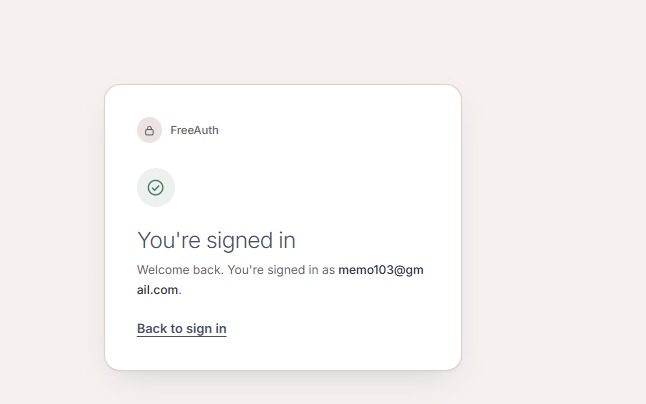
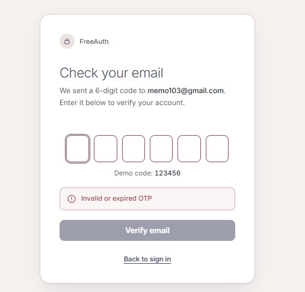
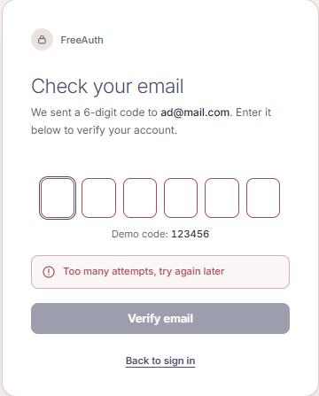
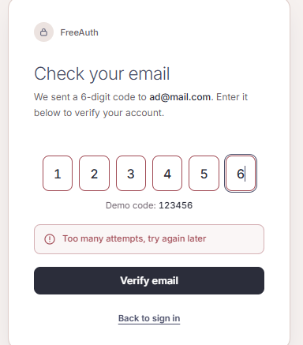

# Auth Card

## Overview

Auth Card is a single page with one centered card for signing in, creating an account and verifying an email with a 6-digit code. It is built with React, TypeScript and Tailwind CSS, and it talks to a mock of FreeAuth's auth API (`register`, `verify-email`, `login`) that runs in the browser with the same messages and status codes as the real endpoints. There is no backend: everything resets when you reload the page.

## Getting started

You need **Node.js 20.19+ or 22.12+** (Vite 8's requirement) and npm.

```bash
npm install
npm run dev
```

Then open the URL Vite prints (usually http://localhost:5173).

Other scripts:

```bash
npm run build     # type-check (tsc -b) and build to dist/
npm run preview   # serve the built dist/ folder
```

## Demo data

| What | How |
|---|---|
| Seeded, verified user | `ada@example.com` / `Str0ng!Pass` |
| OTP code | always `123456` |
| **409** Email already in use | Register with `ada@example.com` |
| **401** Invalid email or password | Sign in with a wrong password, or an email that has no account |
| **403** Please verify your email | Register a new account, click **Back to sign in** on the code screen, then sign in with it. The error has a **Verify your email** button that opens the code screen. |
| **400** Invalid or expired OTP | Enter any code other than `123456` |
| **429** Too many attempts | Enter a wrong code 5 times. The 5th wrong try returns 429 and locks that email for 15 minutes (reload the page to reset the mock) |
| **422** Validation failed (`errors[]`) | Use an email longer than 100 characters, e.g. `aaaaaaaaaaaaaaaaaaaaaaaaaaaaaaaaaaaaaaaaaaaaaaaaaaaaaaaaaaaaaaaaaaaaaaaaaaaaaaaaaaaaaaaaaaa@example.com`. The error appears under the Email field. |

Accounts you register live in memory until you reload.

## Project structure

```
src/
  main.tsx                 React entry point
  App.tsx                  Page layout: centers the card
  index.css                Tailwind import + @theme design tokens (colors, radii, shadow)
  types.ts                 AuthView union and the FieldError shape
  lib/
    mockApi.ts             register / verifyEmail / login with setTimeout, ApiError class
    passwordRules.ts       The password rules (one source of truth) + strength score
    validation.ts          Human error messages for email, passwords and confirm
    useFormState.ts        Small hook: values, when to show errors, focus first invalid field
  components/
    AuthCard.tsx           Holds the current view and switches between the three forms
    ViewHeader.tsx         The view's <h1>, focused when the view changes
    LoginForm.tsx          Login + the "You're signed in" state
    RegisterForm.tsx       Register with the strength indicator
    OtpForm.tsx            Code entry, submit, success redirect to Login
    ui/
      TextField.tsx        Label + input + error, wired with aria-invalid / aria-describedby
      PasswordField.tsx    TextField with a show/hide toggle button
      PasswordStrength.tsx Strength bar, text label and rules checklist
      OtpInput.tsx         Six digit boxes: typing, backspace, arrows, paste, autofill
      Button.tsx           Primary and link buttons, loading state with spinner
      Alert.tsx            Error (role="alert") and success messages
      icons.tsx            The few inline SVG icons
```

How it fits together: `AuthCard` keeps one `AuthView` in state. Each form gets callbacks such as `onRegistered(email)` or `onVerifyEmail(email)`, and calls them to move to the next view. The `otp` view always carries an email, so the code screen can't exist without one. The forms call the functions in `lib/mockApi.ts` and turn `ApiError`s into messages: errors with a matching `errors[]` field go under that field, everything else goes into an alert. `RegisterForm` and `PasswordStrength` both read `lib/passwordRules.ts`, so the checklist and the validation can't disagree.

## Screenshot

| Login | Register | OTP |
|---|---|---|
|  |  |  |

| Wrong code | Lockout (429) | Full page |
|---|---|---|
|  |  |  |

## How auth works

TODO (Manar)

## Decisions & notes

TODO (Manar)
